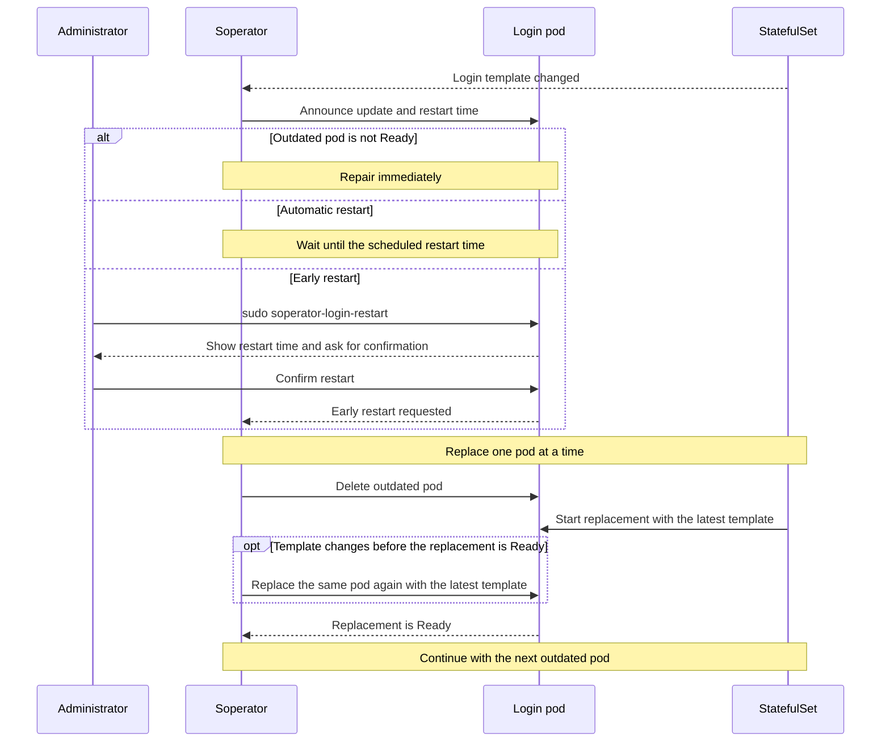

# Delayed login pod updates

Soperator delays login pod updates to give users time to prepare. It replaces outdated pods one at a time,
waiting for each replacement to become Ready at the latest revision before moving on. A newer template change
continues the same replacement without another notice period. Administrators can request an earlier restart from the login node.
Outdated pods that are not Ready are repaired immediately, ahead of healthy pods, without waiting for notice or cron.
Replacing a pod ends its SSH connections, tmux sessions and other processes.

## Configuration

Configure each SlurmCluster under `spec.slurmNodes.login`. In the `slurm-cluster` Helm chart:

```yaml
slurmNodes:
  login:
    updateStrategy: delayedRollout
    updatePolicy:
      minNotice: "720h"
      # Optional: first day of the month at 00:00 UTC.
      # schedule: "0 0 1 * *"
```

| Setting | Description |
| --- | --- |
| `updateStrategy` | `delayedRollout` (default) delays replacement. `rollingUpdate` uses automatic StatefulSet rolling updates. |
| `updatePolicy.minNotice` | Minimum notice before automatic replacement of a Ready pod. Default: `720h` (30 days); `0s` is allowed. |
| `updatePolicy.schedule` | Optional five-field cron, UTC by default. Selects the first occurrence at or after the notice period ends. Without it, replacement is due when `minNotice` expires. |

Later template changes preserve the original notice period. Changing the policy recalculates pending restart
times from the original announcement and can move them earlier or later. Overdue updates remain eligible.

The `loginupdate` controller is enabled by default. Disable it through
`controllerManager.manager.controllersEnabled.loginupdate: false` in the `soperator` Helm chart to pause delayed
replacements. Set the global retry interval with `--requeue-after-login-update` (default: `1m`) through
`controllerManager.manager.args` in that chart.

## How a login update works

Run `sudo soperator-login-restart` on a login node to request an early restart and confirm interactively.
Use `--status` to inspect whether the node is outdated and its restart time, or `--yes` to submit without prompting.
An early request bypasses the notice and schedule while preserving availability checks.

Interactive Bash sessions in SSH and IDE terminals warn about scheduled restarts.
Already-open sessions warn at the next prompt; noninteractive commands stay silent.
Displayed times use the login node's local timezone and omit fractional seconds.



## Other shells

Automatic warnings are currently configured only for Bash. The
[Bash adapter](../ansible/roles/soperator_scripts/files/login_warning_profile.sh) is installed at
`/etc/profile.d/soperator-login-warning.sh`. Login Bash shells load it through `/etc/profile`; the loader in
`/etc/bash.bashrc` also covers non-login interactive terminals, including IDE terminals.

To integrate another shell:

1. Add an adapter to that shell's startup configuration in the shared jail. No image rebuild is needed.
2. Register its native before-prompt hook only for interactive sessions where `/run/soperator-login-state` exists.
3. Call the shared checker from that hook, preserving existing hooks and the previous command's exit status.

For shells with compatible syntax, follow the Bash adapter: source `/usr/lib/soperator/login_warning.sh --source`
once during startup, then call `_soperator_warn_outdated_login "$?"` from the native prompt hook, passing the
previous command's exit status. The checker remembers the schedule inside the shell; no separate marker is needed.

Shells that cannot source the checker can execute it with `--check` instead. Start with an empty schedule
marker, then save stdout and pass that value back at the next prompt. For example, in shell-style pseudocode:

```sh
previous_schedule=""
# Before each prompt:
previous_schedule=$(/usr/lib/soperator/login_warning.sh --check "$previous_schedule")
```

Keep this variable unexported. Warnings go to stderr, which should remain connected to the terminal.
Open a new terminal, or source the adapter once in an existing terminal, to activate the integration.

## Monitoring

The operator exposes these gauges for delayed login rollouts. They use `resource_namespace` and `slurm_cluster`
labels, with `controller="loginupdate"`.

| Metric | Description |
| --- | --- |
| `soperator_login_rollout_active` | Whether an update or login pod readiness/replacement is still pending. |
| `soperator_login_rollout_outdated_pods` | Observed login pods outside the target revision. |
| `soperator_login_rollout_next_restart_timestamp_seconds` | Earliest scheduled restart among remaining outdated pods, or `0` when none exists. |
| `soperator_login_rollout_waiting{reason}` | Current wait reason, including the notice period, pod readiness, or a reconciliation error. |
| `soperator_login_rollout_pod_state{login_pod}` | Rollout state for each login node, preserving its name across replacements. |

Pod states are `0` Ready at target revision, `1` notice period, `2` eligible for restart, `3` replacing, `4` target pod not Ready, and `5` awaiting a target revision or schedule.

The [Soperator / Rollouts dashboard](../helm/soperator-monitoring-dashboards/dashboards/operator_rollouts.json)
includes login panels alongside worker rollouts. Metrics reflect the last controller observation. A pending notice period is expected waiting; early requests and broken pods can trigger
replacement before the reported scheduled time.
