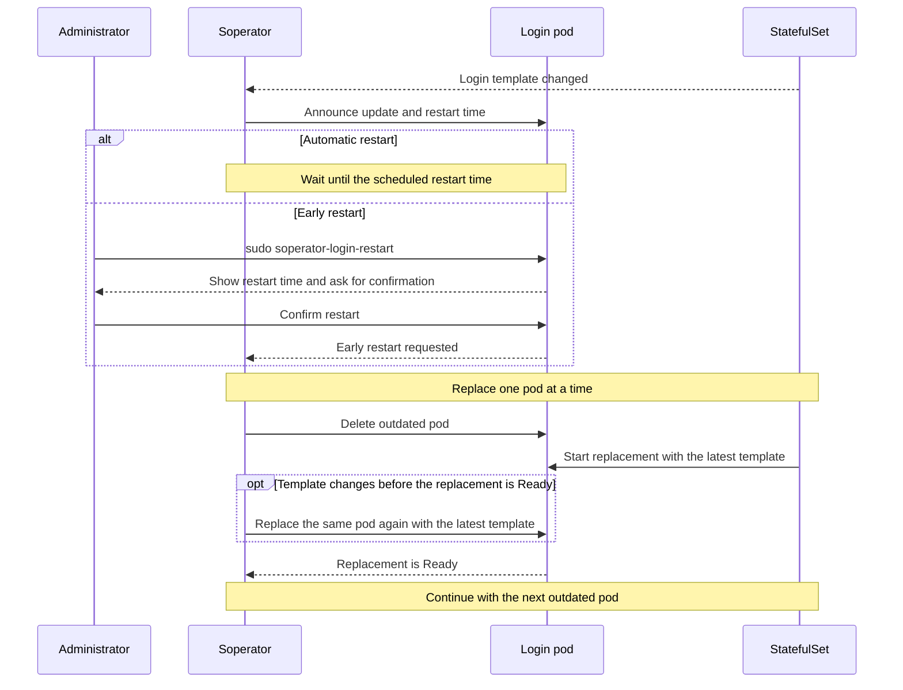

# Delayed login pod updates

Soperator delays login pod updates to give users time to prepare. It replaces outdated pods one at a time,
waiting for each replacement to become Ready at the latest revision before moving on. A newer template change
continues the same replacement without another notice period. Administrators can request an earlier restart from the login host.
Replacing a pod ends its SSH connections, tmux sessions and other processes.

## Configuration

Configure each SlurmCluster under `spec.slurmNodes.login`. In the `slurm-cluster` Helm chart:

```yaml
slurmNodes:
  login:
    updateStrategy: delayedRollout
    updatePolicy:
      minNotice: "720h"
      # Optional: first day of the month at 00:00 UTC.
      # schedule: "0 0 1 * *"
```

| Setting | Description |
| --- | --- |
| `updateStrategy` | `delayedRollout` (default) delays replacement. `rollingUpdate` uses automatic StatefulSet rolling updates. |
| `updatePolicy.minNotice` | Minimum notice before automatic replacement. Default: `720h` (30 days); `0s` is allowed. |
| `updatePolicy.schedule` | Optional five-field cron, UTC by default. Selects the first occurrence at or after the notice period ends. Without it, replacement is due when `minNotice` expires. |

Later template changes preserve the original notice period. Changing the policy recalculates pending restart
times from the original announcement and can move them earlier or later. Overdue updates remain eligible.

The `loginupdate` controller is enabled by default. Disable it through
`controllerManager.manager.controllersEnabled.loginupdate: false` in the `soperator` Helm chart to pause delayed
replacements. Set the global retry interval with `--requeue-after-login-update` (default: `1m`) through
`controllerManager.manager.args` in that chart.

## How a login update works

Run `sudo soperator-login-restart` on a login host to request an early restart and confirm interactively.
Use `--status` to inspect its restart time, or `--yes` to submit without prompting. An early request bypasses
the notice and schedule while preserving availability checks.


